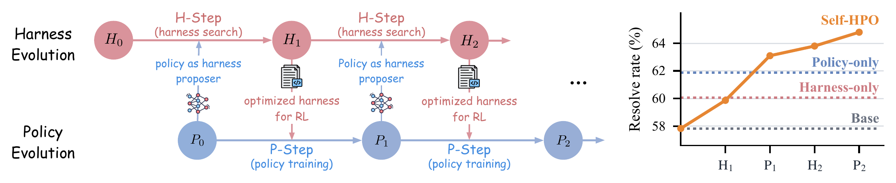
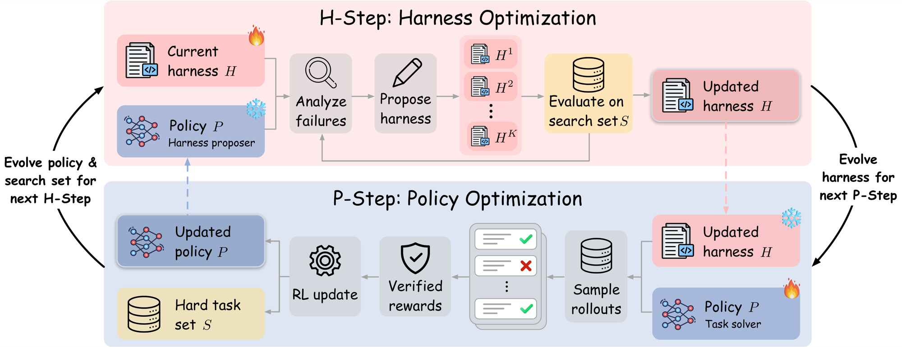

# Self-HPO: Self-Evolving Coding Agents via Harness-Policy Optimization

[](https://arxiv.org/abs/2610.22791)
[](https://huggingface.co/self-hpo)

Self-HPO co-evolves the **harness** and the **policy** of an LLM coding agent. Each round alternates two steps:

1. **H-step**: the current policy analyzes its own failures and proposes harness revisions. The best candidate becomes the harness for the next P-step.
2. **P-step**: RL updates the policy under the harness from the preceding H-step. The tasks it never solves become the search set of the next H-step.

<p align="center"></p>

---

## Released policies and harnesses

We release the policies and harnesses below, with their resolve rates (%) on SWE-Bench Verified, SWE-Bench Multilingual, and SWE-Bench Pro. Both HPO and Self-HPO alternate H-steps and P-steps. In the H-step, HPO uses Claude Opus 4.8 to propose harness revisions, while Self-HPO uses the current policy itself.

| Setting | Policy | Harness | SWE-Verified | SWE-Multi | SWE-Pro | Avg. |
|---|---|---|---|---|---|---|
| Base | [`Qwen3.5-35B-A3B`](https://huggingface.co/Qwen/Qwen3.5-35B-A3B) | [`seed`](https://github.com/MSR-Orchard/Self-HPO/tree/main/harnesses/seed) | 61.0 | 54.2 | 58.3 | 57.8 |
| HPO | [`HPO-Qwen3.5-35B-A3B`](https://huggingface.co/self-hpo/HPO-Qwen3.5-35B-A3B) | [`hpo`](https://github.com/MSR-Orchard/Self-HPO/tree/main/harnesses/hpo) | 71.6 | 61.4 | 66.0 | 66.3 |
| Self-HPO | [`Self-HPO-Qwen3.5-35B-A3B`](https://huggingface.co/self-hpo/Self-HPO-Qwen3.5-35B-A3B) | [`self-hpo`](https://github.com/MSR-Orchard/Self-HPO/tree/main/harnesses/self-hpo) | 69.5 | 59.7 | 65.2 | 64.8 |

---

## Installation

- **GPUs.** We used 8 B200 GPUs for both evaluation and training.
- **Virtual environment.** We use Python 3.12 and [uv](https://github.com/astral-sh/uv). The commands below create the environments. `setup.sh all` also downloads the RL training data and the SWE-bench Pro test scripts.

  ```bash
  source scripts/env.sh
  bash scripts/eval/setup.sh all
  ```
- **Sandbox service.** Each task runs in a remote container managed by [Orchard](https://github.com/microsoft/Orchard-Agentic/tree/main/orchard_env). Export its endpoint and API key before use:

  ```bash
  export SANDBOX_BASE_URL=http://<orchard-endpoint>
  export SANDBOX_API_KEY=<key>
  ```

---

## Quick start for evaluation

1. **Serve a policy.** This starts one SGLang replica per GPU and prints `SERVE_READY` when every replica answers. Keep it running in a separate terminal or tmux.

   ```bash
   bash scripts/eval/serve_model.sh --model self-hpo/Self-HPO-Qwen3.5-35B-A3B --ngpu 8
   ```
2. **Generate trajectories.** `--benchmark` is `sbv`, `multi`, or `sbp`, and `--harness` should match the served policy. Each run creates a new directory under `work/eval/<method>/<benchmark>/`.

   ```bash
   bash scripts/eval/gen_traj.sh --method Self-HPO --benchmark sbv --harness self-hpo --ngpu 8
   ```
3. **Score.** `score_traj.sh` grades one run, and `results.py` lists the resolved rate of every run and their average.

   ```bash
   bash scripts/eval/score_traj.sh --run work/eval/Self-HPO/SWE_Bench_Verified/<run>
   python3 scripts/eval/results.py -m Self-HPO
   ```

---

## Running Self-HPO

<p align="center"></p>

Each round `R` runs an H-step and then a P-step. Round 1 starts from `Qwen/Qwen3.5-35B-A3B` and `harnesses/seed`. Later rounds start from the previous round's `work/p_step_$((R-1))/policy` and `work/harness_$((R-1))`.

### H-step: harness optimization

1. **Serve the policy.** The served policy runs the search-set evaluation. In Self-HPO it also proposes the harness revisions. In HPO an API model proposes them. Serve it on the default port 8000, which the H-step scripts expect.

   ```bash
   bash scripts/h_step/setup.sh

   # Round 1: serves the base policy
   bash scripts/eval/serve_model.sh --model Qwen/Qwen3.5-35B-A3B --ngpu 8

   # Round R > 1: serves the previous round's policy
   bash scripts/eval/serve_model.sh --model work/p_step_$((R-1))/policy --ngpu 8

   # Optional: use an API model as the proposer (HPO)
   export PROPOSER=api ANTHROPIC_API_KEY=<key> PROPOSER_MODEL=claude-opus-4-8
   ```
2. **Build the search set.**

   ```bash
   # Round 1: samples 300 training tasks
   bash scripts/h_step/build_search_set.sh random --sample 300 \
       --train work/rl/data/train.jsonl --out work/search_set_1

   # Round R > 1: uses the tasks the previous P-step never solved
   bash scripts/h_step/build_search_set.sh hard --rollouts work/p_step_$((R-1))/trajectories \
       --train work/rl/data/train.jsonl --out work/search_set_$R
   ```
3. **Run the search.** The search saves the best harness to `work/harness_$R`.

   ```bash
   # Round 1: starts from the seed harness
   bash scripts/h_step/init.sh work/h_step_1 harnesses/seed work/search_set_1

   # Round R > 1: starts from the previous round's harness
   bash scripts/h_step/init.sh work/h_step_$R work/harness_$((R-1)) work/search_set_$R

   # Search harness candidates and save the best one
   bash scripts/h_step/run_h_step.sh work/h_step_$R work/harness_$R
   ```

### P-step: policy optimization

1. **Set up the container.** The P-step runs in the `slimerl/slime:v0.3.0` container on one 8-GPU node.

   ```bash
   # Start the container
   docker run --rm -it --gpus all --ipc=host \
       --shm-size=16g --ulimit memlock=-1 --ulimit stack=67108864 \
       -v $PWD:/workspace/Self-HPO -w /workspace/Self-HPO \
       -e SELFHPO_WORK=/workspace/Self-HPO/work -e SANDBOX_BASE_URL -e SANDBOX_API_KEY \
       slimerl/slime:v0.3.0 bash

   # Inside the container: install the P-step dependencies
   bash scripts/p_step/setup_container.sh
   ```
2. **Train the policy.** RL trains the policy under the harness from the H-step, and `export_policy.sh` saves the trained policy to `work/p_step_$R/policy`.

   ```bash
   # Round 1: starts from the base policy
   bash scripts/p_step/run_p_step.sh --policy Qwen/Qwen3.5-35B-A3B --harness work/harness_1 --out work/p_step_1

   # Round R > 1: starts from the previous round's policy
   bash scripts/p_step/run_p_step.sh --policy work/p_step_$((R-1))/policy --harness work/harness_$R --out work/p_step_$R

   # Export the trained policy
   bash scripts/p_step/export_policy.sh work/p_step_$R
   ```

---

## Bugs or Questions?

If you have any questions related to the code or the paper, feel free to email Zhepei (zhepei.wei@virginia.edu). If you encounter any problems when using the code, or want to report a bug, feel free to open an issue! Please try to specify the problem with details so we can help you better and quicker!

## Citation

If you find this codebase useful, please consider citing:

```bibtex
@article{wei2026selfhpo,
  title   = {Self-Evolving Coding Agents via Harness-Policy Optimization},
  author  = {Wei, Zhepei and Yao, Wenlin and Peng, Baolin and Wang, Danqing and Wu, Qianhui and Cheng, Hao and Meng, Yu and Gao, Jianfeng},
  journal = {arXiv preprint arXiv:2610.22791},
  year    = {2026},
  url     = {https://arxiv.org/abs/2610.22791}
}
```

## License

The code in this repository is released under the [MIT License](LICENSE) © Microsoft Corporation. The bundled [mini-swe-agent](mini-swe-agent/LICENSE.md) and [slime](slime/LICENSE) keep their own licenses.
